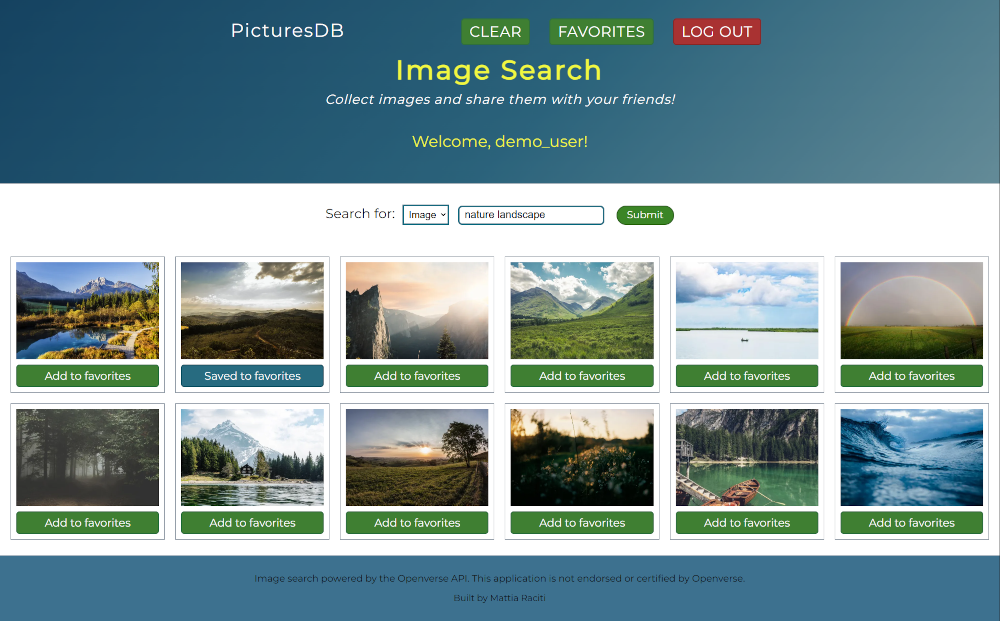
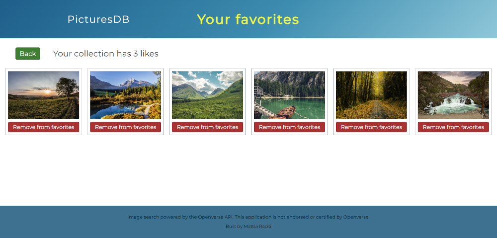

# PicturesDB

PicturesDB is a Laravel application for searching, saving, and browsing images.

It was originally created in 2022 as a course project at the University of Catania. In 2026, I restored
the application and replaced its discontinued Bing Image Search/RapidAPI
integration with the Openverse API.

## Screenshots

### Image Search

### Favorites

## Features

- User registration and login
- Image search through Openverse
- Save and manage personal favorite collections
- User search and public favorite browsing
- Like and unlike other users’ favorite collections
- Grid-based image results

## Built with

- PHP
- Laravel
- Blade
- JavaScript
- HTML
- CSS
- SQL (MariaDB)
- Composer
- Git and GitHub
- Openverse Images API
- Apache/XAMPP for local development

## Local requirements

- PHP 8.0.2 or later
- Composer
- MariaDB

## Openverse

This application uses the Openverse API and is not endorsed or certified by
Openverse.
